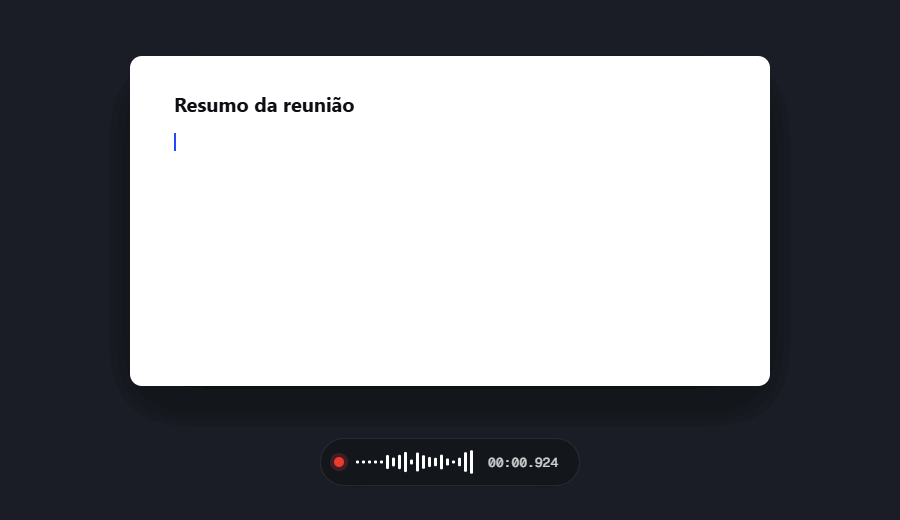
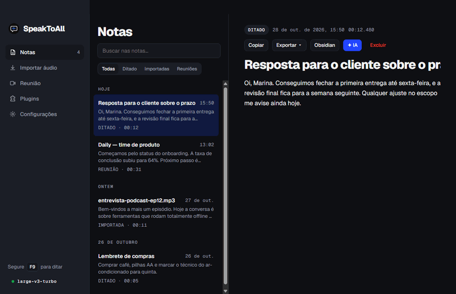
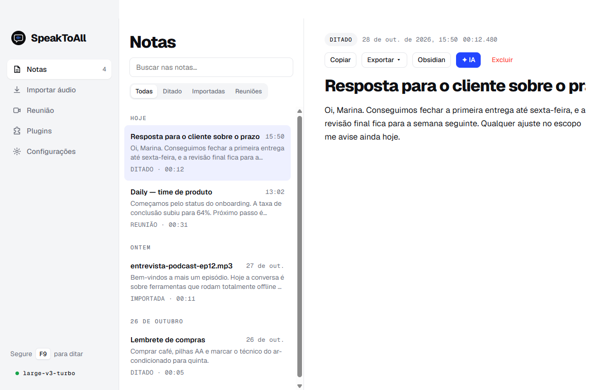
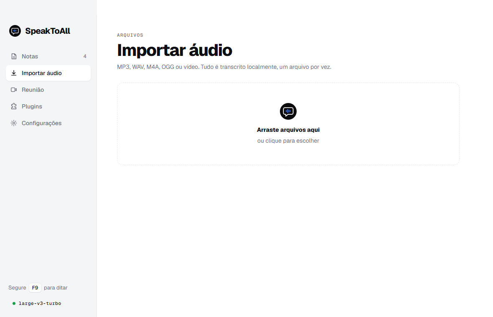
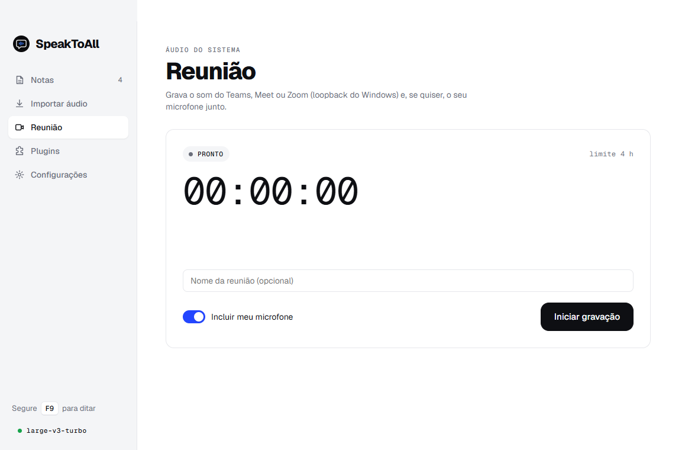
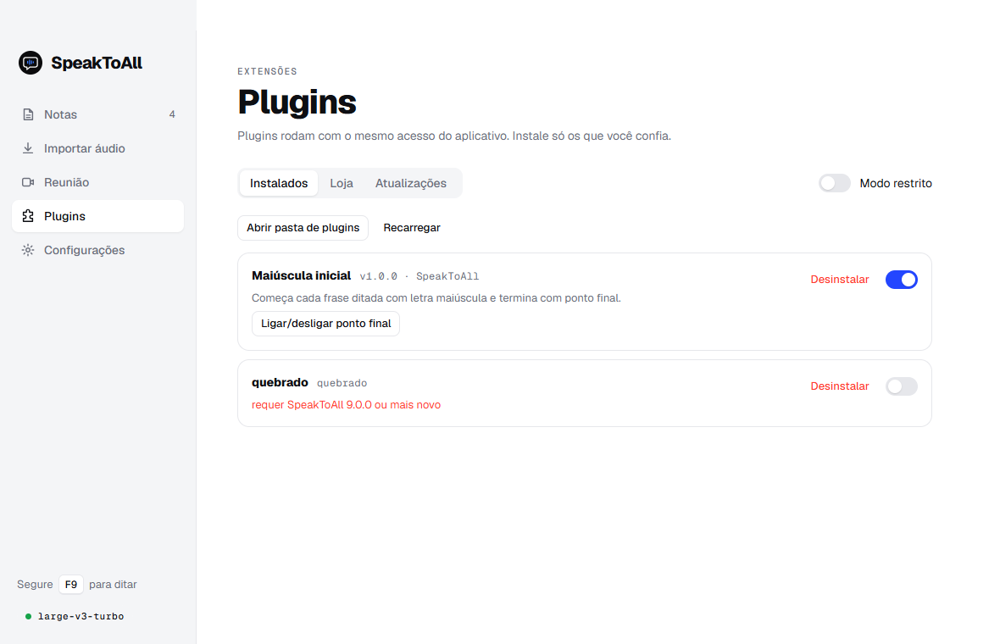
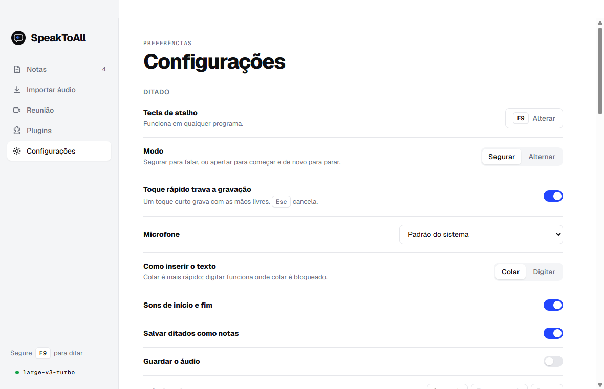

<p align="center">
  
</p>

<h1 align="center">SpeakToAll</h1>

<p align="center"><strong>Fale. Vira texto. Em qualquer lugar.</strong></p>

<p align="center">
  <a href="https://github.com/LucasTrombiniBatista/SpeakToAll/releases/latest">Baixar para Windows</a> ·
  <a href="docs/arquitetura.md">Como funciona</a> ·
  <a href="docs/plugins.md">Plugins</a>
</p>

<p align="center">
  
</p>

App desktop para Windows que transcreve sua voz **offline** e digita o resultado em qualquer programa. Segure uma tecla (padrão <kbd>F9</kbd>), fale, solte — o texto aparece onde o cursor estiver e fica salvo como nota.

Stack: Electron + JavaScript puro como casca, reconhecimento de voz pelos binários do [whisper.cpp](https://github.com/ggml-org/whisper.cpp), injeção de texto pelo `SendInput` do Win32.

## Funcionalidades

- **Ditado global** — segurar para falar, toque rápido para gravar com as mãos livres, <kbd>Esc</kbd> cancela.
- **Notas** — todo ditado vira nota pesquisável; exporta `.txt`, `.md` e `.srt`.
- **Importar áudio** — MP3/WAV/M4A/vídeo transcritos em fila, com o texto aparecendo ao vivo.
- **Reunião** — grava o áudio do sistema (Teams/Meet/Zoom) + microfone e transcreve.
- **IA opcional** — resumo e chat sobre a nota via API compatível com OpenAI: local (Ollama, LM Studio) ou na nuvem com chave (OpenAI, OpenRouter, Groq).
- **Integração com o Obsidian** — envia a nota ao seu vault com título, pasta e tags sugeridos pela IA; você revisa e confirma.
- **Plugins** — estendem o ditado e a bandeja; veja [docs/plugins.md](docs/plugins.md).
- **Offline por padrão** — o áudio nunca sai do computador; o texto só sai se você escolher uma IA na nuvem.

<p align="center">
  
</p>

### Notas

<picture>
  <source media="(prefers-color-scheme: dark)" srcset="docs/media/notes-dark.png">
  
</picture>

### Importar áudio e reunião

<table>
  <tr>
    <td><picture><source media="(prefers-color-scheme: dark)" srcset="docs/media/import-dark.png"></picture></td>
    <td><picture><source media="(prefers-color-scheme: dark)" srcset="docs/media/meeting-dark.png"></picture></td>
  </tr>
</table>

### Plugins e configurações

<table>
  <tr>
    <td><picture><source media="(prefers-color-scheme: dark)" srcset="docs/media/plugins-dark.png"></picture></td>
    <td><picture><source media="(prefers-color-scheme: dark)" srcset="docs/media/settings-dark.png"></picture></td>
  </tr>
</table>

### Tema claro e escuro

Segue o Windows ou fica fixo; a barra de título acompanha. Em Configurações → Janela dá para abrir em janela, maximizado ou tela cheia (<kbd>F11</kbd> alterna).

<p align="center">
  
</p>

## Instalar

Baixe o `SpeakToAll Setup <versão>.exe` em [Releases](https://github.com/LucasTrombiniBatista/SpeakToAll/releases/latest). Requisitos: Windows 10/11 x64 e ~200 MB livres para motor + modelo `base` (até ~600 MB com `large-v3-turbo`).

**Atualizações:** novas versões são baixadas em segundo plano. Quando ficam prontas aparece um aviso discreto; ao reiniciar (ou ao sair do app) a instalação acontece em silêncio, sem abrir o instalador de novo. Dá para desligar a verificação automática em Configurações.

## Desenvolvimento

Requer Node.js 20+ (o projeto usa 24, veja `.nvmrc`).

```bash
npm install
npm start
```

Na primeira execução o assistente detecta o hardware e baixa o whisper.cpp e o modelo para `%APPDATA%\speaktoall`.

Para ver só a interface no navegador (sem Electron, com dados falsos), abra `src/renderer/main/index.html`.

```
SpeakToAll/
├── assets/                 # ícones do app, da bandeja e do instalador (SVG + gerados)
├── build/                  # recursos do instalador (ICO, sidebar)
├── docs/                   # documentação (docs/media: capturas do README)
├── examples/plugins/       # plugin de exemplo
├── scripts/                # gerar ícones e capturas do README
├── src/
│   ├── main/               # processo principal (Node) — backend
│   ├── preload/            # pontes seguras main ↔ renderer (window.wp)
│   ├── renderer/
│   │   ├── common/         # tokens.css, audio.js, pcm-worklet.js, wp-mock.js
│   │   ├── main/           # janela principal (notas, importar, reunião, config, onboarding)
│   │   └── overlay/        # pílula de gravação
│   └── common/locales/     # traduções
└── test/                   # testes (node --test)
```

## Documentação

| Documento | Conteúdo |
|---|---|
| [docs/arquitetura.md](docs/arquitetura.md) | Visão geral, processos, fluxo de um ditado, onde ficam os dados |
| [docs/modulos.md](docs/modulos.md) | Cada módulo do backend e do front-end, API e eventos |
| [docs/ipc.md](docs/ipc.md) | Contrato `window.wp`: canais, eventos, comandos do overlay, formatos |
| [docs/design-system.md](docs/design-system.md) | Identidade visual, tokens, componentes, ícones, barra de título |
| [docs/integracoes.md](docs/integracoes.md) | Integração com o Obsidian e como adicionar novas |
| [docs/plugins.md](docs/plugins.md) | Como escrever e instalar plugins |
| [docs/desenvolvimento.md](docs/desenvolvimento.md) | Como testar, distribuir, armadilhas conhecidas, pendências |

## Licença

Veja [LICENSE](LICENSE).
